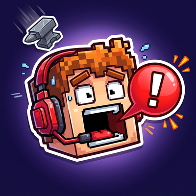

# Blurt: Minecraft voice party game mod

**Don't say the forbidden word. Your microphone is listening.**

Blurt turns Minecraft into a voice party game. A round starts, everyone's microphone opens, and the server secretly picks a word. Say it out loud, even by accident, and something terrible falls on your head. Say it again and it gets worse.

I made it because "Minecraft but if I say X…" videos are the funniest thing on the internet, but every mod behind them does one trick, speaks one language, or needs a voice chat mod and a lot of setup. Blurt is the whole game: rounds, rules, scores, rewards, and speech recognition that runs on your own PC.

## Game modes

- **Taboo:** one secret word from a pool (everyday words, Minecraft words, filler words like "like" and "bro", or your own list). Whoever says it is punished, harder every time. The word is revealed at the end with the score list.
- **Rule Roulette:** a new silly rule every two minutes. 20 rules: *Don't say "night"*, *Whisper only*, *SHOUT everything you say*, *Never stop talking*, *Talk less (yap meter)*, *Don't scream*, *Don't say anyone's name*, *No jumping*, *Don't look down*, *Stay out of the water*, *Don't move*, *Kill a mob before this rule ends*… Obey a rule from start to end and you get a reward.
- **Secret Words:** everyone gets their own forbidden word. Everybody can see it except you. Trick your friends into saying theirs.
- **Overused:** every word you say is counted. Say one three times and it becomes forbidden for everyone.
- **Quiet:** monsters can hear your voice. The louder you talk, the farther it carries. Screaming calls something out of the dark.
- **Vanish:** say any block's name and every block of that kind in your chunk disappears, from bedrock to the sky.
- **Summon:** say a mob's name and it appears in front of you.

## Penalties and rewards

43 penalties in three tiers, getting worse with every slip: blindness, chicken rain, lightning, a random teleport, mob packs, anvil rain, being launched into the sky, phantom squads, one heart left, a fake crash screen, chicken jockeys, a giant sneeze, a white flash, fake "village 385 blocks west" tips, bare hands that hurt… From the fourth slip on, they come in combos.

**Nothing is ever lost.** No item is deleted, no griefing explosion, no real crash. Obeying rules gives food, iron, gold, diamonds, golden apples and a **Blurt shield** that cancels your next penalty. Switch to creative mode in the middle of a round to escape? The warden comes for you.

## It actually understands you

- **8 voice languages:** English, Español, Türkçe, Deutsch, Français, Português, Italiano, Русский. Plurals and case endings count ("diamonds", "алмазы", "elması").
- **Offline.** Speech is written down on your own PC with whisper.cpp. Nothing you say leaves your computer outside a round, and nothing is stored.
- **No made-up words.** Every sentence is decoded twice and dropped when the two tries disagree, so game noise and breathing don't get you punished.
- **Loudness that's fair:** the mod learns how loud *you* normally talk, so "whisper only" and "shout" work the same with any microphone.
- **Typing doesn't save you:** the forbidden word typed in chat counts too.

## Commands (op or single player)

`/blurt start [pool] [seconds]` · `/blurt rules [seconds] [rule seconds]` · `/blurt secrets` · `/blurt overused` · `/blurt quiet` · `/blurt vanish` · `/blurt summon` · `/blurt custom word, word, …` · `/blurt stop` · `/blurt stats` · `/blurt top`

Server owners can tune everything in `config/blurt-server.json`: penalties on/off, round length, cooldown, "everyone pays" mode, free warnings for younger players, a custom penalty command and more.

## Good to know

- **Requires Blurt Core** (the speech engine) and, on Fabric, Fabric API.
- Install on **both client and server**. Players without the mod can still join, they just can't be heard.
- The first round downloads the speech model once (190 MB, from Hugging Face). Press **J** to pick your microphone, the voice language and the quality.
- Works with **Simple Voice Chat** if you have it (one microphone for both mods), and perfectly fine without it.
- Wear headphones: penalties are loud, and you don't want your speakers to say the word for you.
- Made for friends and streams, not for competitive servers.

## Download

Each Minecraft version needs **two jars: Blurt and Blurt Core**. Grab both from the [latest release](https://github.com/SpicesFire/Blurt/releases/latest), or the one `blurt-bundle-….zip` for your loader (unzip it and put both jars in your `mods` folder). The same files, with SHA-256 checksums, are on **https://spicesfire.com/blurt/#download**. Modrinth and CurseForge pages are in review.

| Loader | Minecraft | Java | Needs |
|---|---|---|---|
| Fabric | 26.3 | 25 | Fabric API |
| Fabric | 1.21.10 | 21 | Fabric API |
| Fabric | 1.20.1 | 17 | Fabric API |
| NeoForge | 1.21.1 | 21 | – |
| Forge | 1.20.1 | 17 | – |

Install on the server **and** on every player's client (single player counts as both).

## Feedback

This is a beta. Found a word it keeps mishearing, or a penalty that broke something? Open an issue with your Minecraft version, loader and voice language, or tell us on **[Discord](https://discord.gg/RM2gsw92h2)**.

**Website and FAQ: https://spicesfire.com/blurt/** · **Discord: https://discord.gg/RM2gsw92h2**

---

Made by [SpicesFire](https://spicesfire.com/). Not an official Minecraft product. Not approved by or associated with Mojang or Microsoft.
